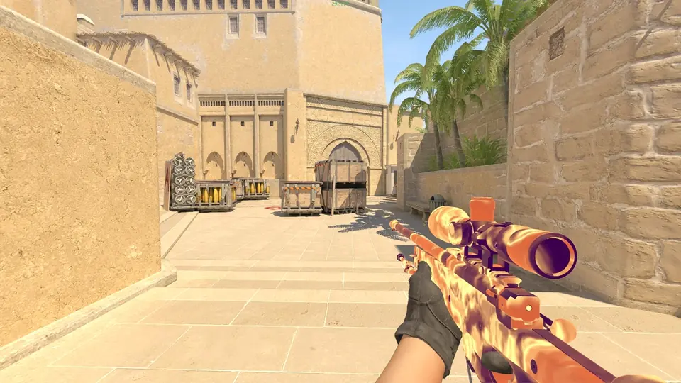
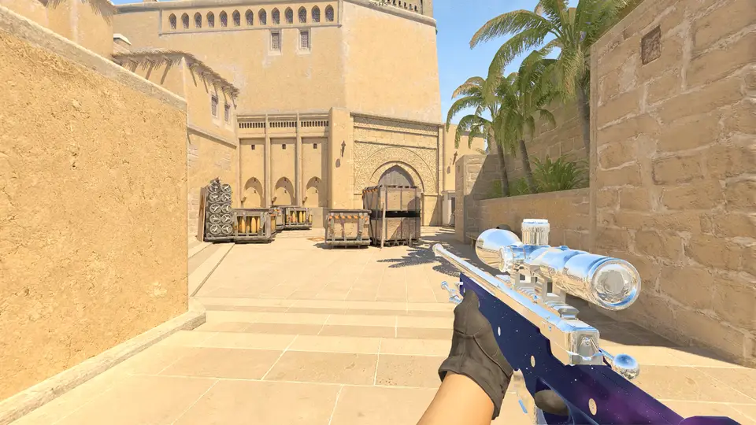

# WeaponFX

**Your own pixel shaders on the weapon and gloves in your hands in Counter-Strike 2.**

Glass that bends the world behind it · a window into space · liquid metal ·
holograms · lava under a glass shell

[**Guide**](GUIDE.md) · [How it works](RENDERING.md) · [License](LICENSE)

 

|  |  |
|:---:|:---:|
| **Chrome**: the map's reflections on polished metal | **Plasma**: molten energy flowing along the weapon |
|  |  |
| **Black hole**: the world bends around a point of nothing | **Masked**: two effects on one weapon, split by a mask |

 

**Write HLSL, save, see it in game** — every save recompiles live

**Weapon and gloves, only on your screen** — others and demos see the normal skin

**Replace the skin or draw over it** — with masks, textures and parameters

**In-game menu** — per-weapon settings, saved to an `.ini`

 

### [Read the guide →](GUIDE.md)

Install, menu, config, writing your own effect, building.

 

> WeaponFX is foreign code inside the game process, made for people who write
> shaders and know how to load a DLL. Use it offline.

> **Maintenance mode.** WeaponFX gets fixes for game updates and little else.
> It is meant to be forked or built into your own tools: take it and make it
> yours.

Like it? <a href="https://pay.cloudtips.ru/p/d7e3ac51">Support the project ♥</a>

MIT licensed. Dear ImGui under <code>third_party/imgui</code> is MIT as well.
