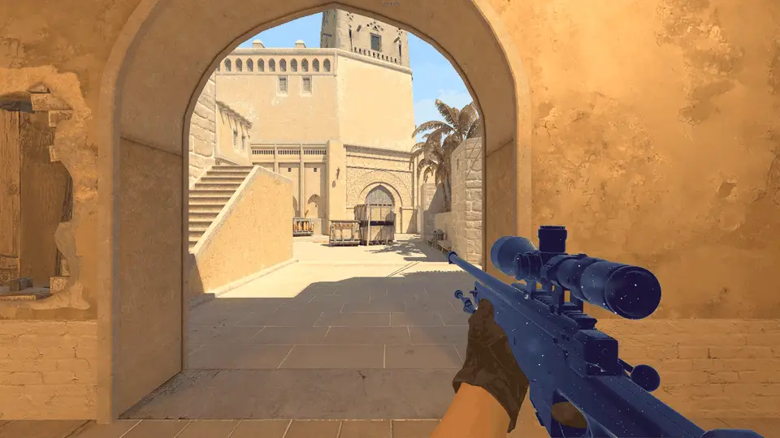
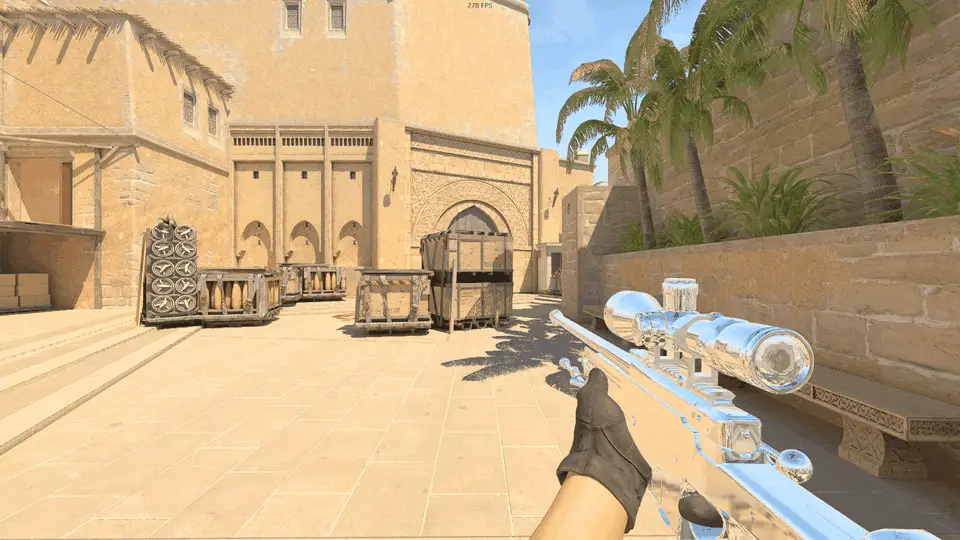
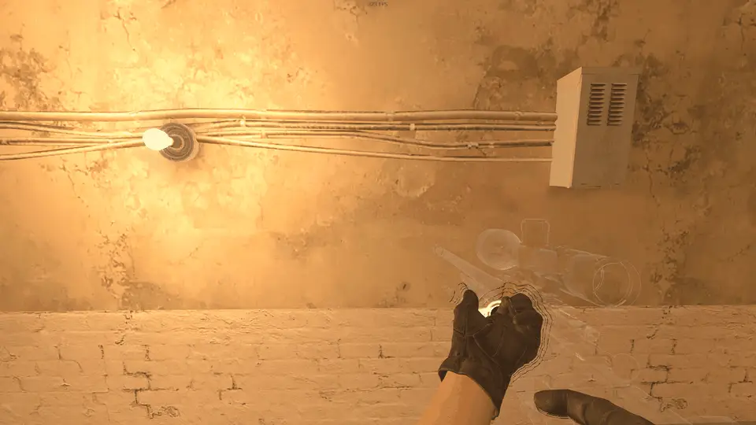

# WeaponFX

**Write your own pixel shaders for the weapon in your hands in Counter-Strike 2.**


CS2 skins can only use the shaders Valve ships. WeaponFX lets you draw the
weapon you are holding with any HLSL pixel shader you write: glass that bends
the world behind it, a window into space, liquid metal, holograms, lava inside
a glass shell. You edit a `.hlsl` file, save it, and the weapon changes in the
game a moment later.

Only your own first-person weapon changes, and only on your screen. Other
players, spectators and demos see the normal skin.

## What it looks like

| | |
|---|---|
|  **See-through.** The weapon is clear and bends the world behind it like a lens. |  **Glass.** Refraction with a prism fringe and a thin reflection at grazing angles. |
|  **Galaxy.** A window into space, with near stars drifting past as you turn. |  **Chrome.** The map's reflections on polished metal. |
|  **Plasma.** Molten energy flowing along the weapon. |  **Hologram.** Rim light, scanlines and glitch flicker. |
|  **Lava.** Molten lava churning inside a clear glass shell. |  **Masked.** Two effects on one weapon, split by a mask you paint on its texture. |
|  **Black hole.** The world bends around a point of nothing inside the weapon, with a glowing accretion disk. | |

Your fingers hide the weapon and the weapon hides your fingers, as in the
real game:


Any effect can also go over the skin instead of replacing it, so a mask can cut
a window into the skin and leave the rest as it is:


## Quick start

1. **Build** `WeaponFX.dll` (see [Building](#building)).
2. **Copy the `shaders` folder** to `%LOCALAPPDATA%\WeaponFX\`.
3. **Start CS2 offline**: with `-insecure`, on a local server or on a workshop
   map.
4. **Load `WeaponFX.dll` into `cs2.exe`** with any DLL loader. Loading at the
   main menu is fine: it waits for the game to finish starting.
5. **Press Insert** to open the menu, set the mode to `replace` and pick a
   shader.

**End** unloads it and puts the game back the way it was.

> WeaponFX is a tool for people who write shaders and know how to load a DLL.
> It does not ship a loader. It only changes how your own weapon is drawn, but
> it is still foreign code inside the game process. Use it offline.

## Using it

### The menu (Insert)

The menu edits the weapon currently in your hands:

- **Mode**: `replace` draws the weapon with your shader instead of its skin.
  `overlay` draws the skin first and your shader on top. `off` leaves the
  weapon alone.
- **Shader**: every `.hlsl` in the shader folder.
- **Textures and parameters**: values your shader can read. See the top of
  each shader file for what it understands.

Changes show up immediately. **Save to [weapon]** keeps them for this weapon
only, **Save to [default]** for every weapon. While the menu is open the game
gets no mouse or keyboard input.

### weaponfx.ini

The menu writes `weaponfx.ini`, and you can edit it by hand. It lives in
`%LOCALAPPDATA%\WeaponFX\`, next to `weaponfx.log`. Saved changes apply at once.

```ini
[default]                 ; every weapon without a section of its own
mode    = replace         ; replace | overlay | off
shader  = shaders\seethrough.hlsl
tex0    = shaders\masks\stripes.png
param0  = 1 0.04 0 0

[weapon_snip_awp]         ; the AWP gets glass
shader  = shaders\glass.hlsl

[weapon_knife_karambit]   ; the karambit gets chrome
shader  = shaders\chrome.hlsl
```

A section is named after the weapon's model. The log prints it every time you
switch weapons:

```
host: weapon in hands weapons/models/awp/weapon_snip_awp.vmdl
```

A weapon's section overrides `[default]` one key at a time. Skins do not
change the model name, so one section covers every skin of that weapon.

<details>
<summary>All keys</summary>

| Key | Meaning |
|---|---|
| `mode` | `replace`, `overlay` or `off` |
| `shader` | path to the `.hlsl`, relative to the data folder or absolute |
| `tex0` .. `tex3` | images the shader samples by the weapon's UV (`g_fxTex0..3`) |
| `param0` .. `param3` | four numbers each, read as `g_fxParam[0..3]` |
| `vmdepth` | `1` (default): hands and weapon hide each other correctly. Leave it on |

The data folder can be moved by setting the `WEAPONFX_DIR` environment
variable for the game. Paths may contain any characters. Save the file as
UTF-8.
</details>

## Writing your own effect

A minimal effect, a blue metal with the map's reflections at the edges:

```hlsl
#include "weaponfx.hlsli"

float4 main(PSIn i) : SV_Target {
    float3 n = Normal(i);
    float  f = Fresnel(i, 3.0);
    float3 c = lerp(float3(0.1, 0.2, 0.4), Environment(reflect(ViewDir(i), n), 0, 2), f);
    return float4(c, 1);
}
```

Save it next to the other shaders, pick it in the menu, and keep editing. Every
save recompiles it. If it does not compile, the weapon stays as it was and the
compiler's error is in `weaponfx.log`.

The output colour is **premultiplied alpha** over whatever is under the
weapon: alpha 1 covers it, alpha 0 leaves it. In `overlay` mode what is under
is the skin. In `replace` mode, draw the world yourself with `SceneAt`.

What your shader can use (all in [`shaders/weaponfx.hlsli`](shaders/weaponfx.hlsli)):

| | |
|---|---|
| `PSIn i` | position, normal, two UV sets, vertex colour, screen position |
| `Time()` | seconds since the shader was loaded |
| `WorldPos(i)`, `CameraPos()`, `ViewDir(i)`, `Normal(i)`, `ScreenUV(i)` | positions and directions |
| `CameraRight()`, `CameraUp()`, `ScreenNormal(i)` | the camera's axes, the normal on screen |
| `Environment(dir, slice, mip)`, `Fresnel(i, power)` | the map's reflections |
| `SceneAt(i, offsetPx)` | the world behind the weapon, optionally shifted |
| `SceneDistance(px)`, `HasDepth()` | how far away the world is at a pixel |
| `g_fxParam[0..3]` | the four parameters from the menu |
| `g_fxTex0..3`, `Tex0(i)` .. | your images, sampled by the weapon's UV |

The copies of the world and of its depth are only made for shaders that read
them, so an effect that only uses UVs costs nothing extra.

The shipped effects are good starting points; each one explains its parameters
at the top of the file. `debug.hlsl` shows the spaces the helpers use. The
`_probe_*` files are diagnostics and are hidden from the menu.

## Building

Visual Studio 2019 or newer (or the Build Tools) with the C++ workload, x64:

```
build.bat
```

The result is `build\WeaponFX.dll`. No developer prompt is needed: the script
finds the compiler itself. The project builds with warnings as errors at
`/W4`, and needs nothing beyond the Windows SDK. Dear ImGui is included under
`third_party/imgui`.

## Limits

- DirectX 11 only, the game's default on Windows. Vulkan is not supported.
- Only the weapon in your hands: not other players' weapons, not weapons on
  the ground, not your hands or gloves.
- One shader at a time. Switching to a weapon with a different shader
  recompiles, and the first frames of the new weapon may still show the old
  effect.
- After changing the display mode, reload the DLL.

## When a game update breaks it

Look at `weaponfx.log` first. Every step that touches the game logs what it
found or what it could not find. [RENDERING.md](RENDERING.md), section 6,
matches those lines and the visible symptoms to what changed in the game. The
values that move between updates are named constants at the top of
`host/engine.cpp`, `host/material.cpp` and `host/menu.cpp`.

## How it works

In short: WeaponFX gives your weapon a marker material so it can recognise the
weapon's draws inside the game's DirectX 11 calls, takes the weapon out of the
game's depth passes so the world behind it gets drawn, copies that world, and
then draws the weapon again with your shader. The weapon and your hands get a
depth buffer of their own so they still hide each other.

The full story, with the game's frame step by step, every breakage met so far
and what did not work, is in [RENDERING.md](RENDERING.md). Read it before
changing the core.

<details>
<summary>Source layout</summary>

| Path | What |
|---|---|
| `core/weapon_fx.{h,cpp}` | the effect itself: compiling and watching shaders, finding the viewmodel, the world and depth copies, our draw. DirectX 11 and Win32 only, no knowledge of the game |
| `host/patch` | signature scans, detours, code writes with other threads paused |
| `host/d3d_hooks` | `Present`, the DirectX 11 draw calls, `ClearDepthStencilView`; recognising the weapon's draws by the marker |
| `host/engine` | the game's `RenderObjects`: the weapon out of the depth passes and drawn with the marker; which weapon is in hands |
| `host/material` | creating the marker material |
| `host/config` | reading and watching `weaponfx.ini` |
| `host/menu` | the in-game menu |
| `host/dllmain.cpp` | start-up, the per-frame driver, unloading in order |
| `shaders/` | the shared headers and the effects |
</details>

## License

MIT, see [LICENSE](LICENSE). Dear ImGui under `third_party/imgui` is MIT as
well, with its own notice in `third_party/imgui/LICENSE.txt`.
